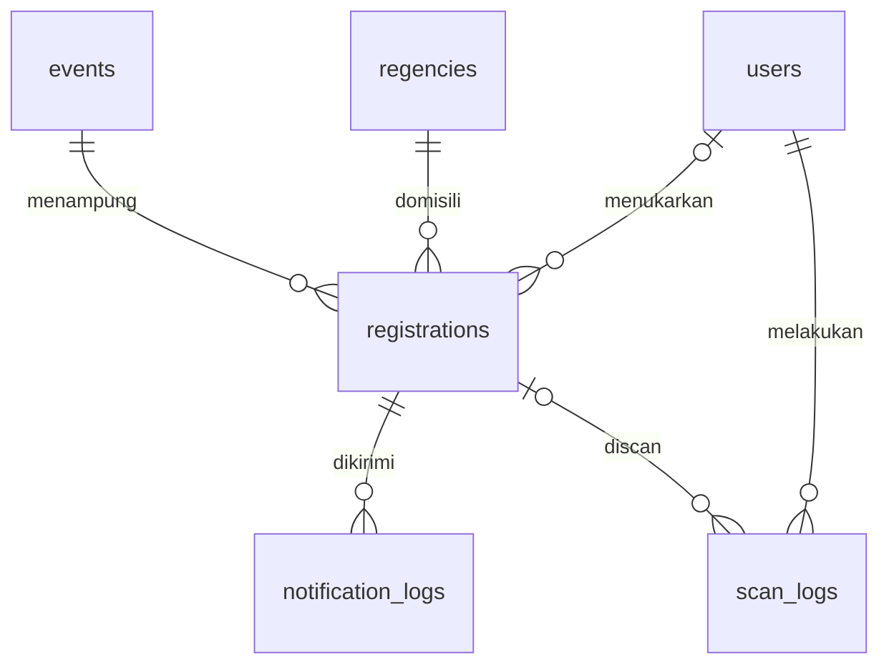

# ERD

Semua tabel InnoDB. Tabel bawaan Laravel (`jobs`, `failed_jobs`, `sessions`, `cache`, `cache_locks`) tetap dipakai; `password_reset_tokens` boleh dihapus karena tidak ada reset password publik.

## events

Satu baris. Target `lockForUpdate()` saat submit.

| Kolom | Migration | Keterangan |
|---|---|---|
| id | `id()` | |
| name | `string('name', 150)` | Opening Ceremony Porprov Jateng XVII 2026 |
| code_prefix | `string('code_prefix', 10)->unique()` | `PJT26` |
| quota | `unsignedInteger('quota')->default(3600)` | |
| tickets_taken | `unsignedInteger('tickets_taken')->default(0)` | Bisa direkonsiliasi dengan `SUM(registrations.ticket_qty)` |
| event_starts_at | `dateTime('event_starts_at')->nullable()` | Ditampilkan di halaman & pesan |
| venue | `string('venue', 200)->nullable()` | Lokasi acara |
| registration_open_at | `dateTime(...)->nullable()` | |
| registration_close_at | `dateTime(...)->nullable()` | |
| is_open | `boolean('is_open')->default(false)` | Saklar manual admin |
| timestamps | `timestamps()` | |

`Event::isOpen()`: `is_open` && (open_at null atau now ≥ open_at) && (close_at null atau now < close_at).

## regencies

Seeder: 35 kabupaten/kota Jawa Tengah + "Luar Jawa Tengah" (sort_order terbesar).

| Kolom | Migration |
|---|---|
| id | `smallIncrements('id')` |
| name | `string('name', 100)->unique()` |
| sort_order | `unsignedSmallInteger('sort_order')` |

## registrations

| Kolom | Migration | Keterangan |
|---|---|---|
| id | `id()` | |
| event_id | `foreignId('event_id')->constrained()->restrictOnDelete()` | |
| code | `string('code', 20)->unique()` | `PJT26-7K3M9Q`, NOT NULL |
| token | `string('token', 64)->unique()` | `Str::random(48)` |
| name | `string('name', 150)` | |
| regency_id | `unsignedSmallInteger('regency_id')` + FK ke `regencies.id` | |
| email | `string('email', 191)` | lowercase, persis seperti diketik peserta; dipakai untuk kirim e-ticket |
| email_canonical | `string('email_canonical', 191)->nullable()` | Bentuk kanonik untuk cek duplikat, lihat `docs/arsitektur.md`. Dikosongkan (`NULL`) saat registrasi dibatalkan (Fase 8), supaya email yang sama bisa dipakai mendaftar ulang — unique index mengizinkan banyak `NULL` |
| phone | `string('phone', 20)` | `62xxx` |
| wa_consent | `boolean('wa_consent')->default(false)` | Ditambahkan Fase 10 (`..._000009_add_wa_consent_to_registrations_table.php`): persetujuan checkbox form ("Kirimi saya tiket dan informasi acara lewat WhatsApp"), tidak tercentang default. Baris `notification_logs` whatsapp `skipped` kalau `false` |
| ticket_qty | `unsignedTinyInteger('ticket_qty')` | 1–4 |
| redeemed_at | `dateTime('redeemed_at')->nullable()->index()` | |
| redeemed_by | `foreignId('redeemed_by')->nullable()->constrained('users')->nullOnDelete()` | |
| cancelled_at | `dateTime('cancelled_at')->nullable()->index()` | Ditambahkan Fase 8 (`App\Actions\CancelRegistration`); registrasi yang sudah `redeemed_at` tidak boleh dibatalkan |
| cancelled_by | `foreignId('cancelled_by')->nullable()->constrained('users')->nullOnDelete()` | Ditambahkan Fase 8; admin yang membatalkan |
| ip_address | `string('ip_address', 45)->nullable()` | |
| verified_via | `enum('verified_via', ['turnstile','captcha'])->nullable()->index()` | Ditambahkan perbaikan form pra-pembukaan (migration `2024_01_01_000008_add_verified_via_to_registrations_table.php`). Jalur anti-bot yang lolos: token Turnstile, atau captcha gambar cadangan. `NULL` untuk data lama dan saat `TURNSTILE_ENABLED=false`. Tidak fillable; diisi `RegisterAttendee` lewat `forceFill`. Tampil dan bisa difilter di daftar peserta admin |
| timestamps | `timestamps()` | |

Index: `unique(['event_id','email_canonical'])` (mengizinkan banyak `NULL`), index biasa `phone` (bukan unique — 1 nomor HP boleh dipakai lebih dari satu pendaftaran), index `name` untuk pencarian manual.

## notification_logs

| Kolom | Migration | Keterangan |
|---|---|---|
| id | `id()` | |
| registration_id | `foreignId(...)->constrained()->cascadeOnDelete()` | |
| channel | `enum('channel', ['email','whatsapp'])` | |
| status | `enum('status', ['pending','sending','sent','failed','skipped'])->default('pending')->index()` | `sending` dan `skipped` ditambahkan Fase 10 (`..._000010_add_sending_skipped_to_notification_logs_status.php`) untuk outbox WhatsApp (`docs/notifikasi.md`): `sending` = klaim atomik `wa:send-next` (dikembalikan ke `pending` kalau menggantung > 10 menit), `skipped` = `wa_consent = false`, tidak pernah dikirim. Kolom diubah lewat `->change()` tanpa `doctrine/dbal` (Laravel 13 native) |
| attempts | `unsignedTinyInteger('attempts')->default(0)` | |
| last_error | `text('last_error')->nullable()` | |
| provider_message_id | `string(...)->nullable()` | |
| sent_at | `dateTime('sent_at')->nullable()` | |
| timestamps | `timestamps()` | |

Index: `unique(['registration_id','channel'])`.

## wa_throttle_states

Baris tunggal (`id = 1`), ditambahkan Fase 10 (`..._000011_create_wa_throttle_states_table.php`): state pacing/circuit-breaker `wa:send-next` (`docs/notifikasi.md` "Outbox WhatsApp"). Disimpan di DB, bukan cache, supaya tidak hilang kalau `cache:clear` dijalankan.

| Kolom | Migration | Keterangan |
|---|---|---|
| id | `id()` | Selalu 1, lihat `App\Models\WaThrottleState::current()` |
| next_allowed_at | `dateTime('next_allowed_at')->nullable()` | Jeda acak 45–90 detik setelah sukses kirim |
| paused_until | `dateTime('paused_until')->nullable()` | Diisi saat circuit breaker terpicu atau `wa:pause` manual |
| pause_reason | `string('pause_reason')->nullable()` | |
| consecutive_failures | `unsignedTinyInteger('consecutive_failures')->default(0)` | Hitungan HTTP 5xx berturut-turut; direset ke 0 oleh kegagalan non-breaker |
| timestamps | `timestamps()` | |

## users

| Kolom | Migration | Keterangan |
|---|---|---|
| id | `id()` | |
| name | `string('name', 100)` | Mis. "Pos 3 - Andi" |
| username | `string('username', 50)->unique()` | Login pakai username |
| password | `string('password')` | |
| role | `enum('role', ['admin','scanner'])` | |
| is_active | `boolean('is_active')->default(true)` | |
| remember_token | `rememberToken()` | |
| timestamps | `timestamps()` | |

Kolom `email` bawaan Laravel dihapus dari migration users.

## scan_logs

| Kolom | Migration | Keterangan |
|---|---|---|
| id | `id()` | |
| registration_id | `foreignId(...)->nullable()->constrained()->nullOnDelete()` | Null jika QR tidak dikenal |
| user_id | `foreignId('user_id')->constrained()` | |
| scanned_value | `string('scanned_value', 255)` | Isi QR/input mentah |
| method | `enum('method', ['camera','hardware','manual'])` | |
| result | `enum('result', ['success','already_redeemed','not_found','cancelled'])` | Nilai `cancelled` ditambahkan Fase 8 (tiket yang sudah dibatalkan admin dipindai) |
| ip_address | `string('ip_address', 45)->nullable()` | |
| scanned_at | `dateTime('scanned_at')->index()` | Tanpa `timestamps()` |
